\begin{titlepage}

\normalfont \normalsize  
\Huge Centro de investigaciones y de estudios avanzados del Instituto Politécnico Nacional  

Cinvestav  

  
 [5pt]

  

\usefont{OT1}{bch}{b}{n}

\Large{Proyecto Final Cómputo de Alto Rendimiento}  

\usefont{T1}{bch}{b}{n}

\LARGE{Integrantes}  

\Large Jhovany Badillo Cruz

\Large Hugo Miranda Cano

\end{titlepage}

{\Large **Especificaciones de las computadoras**}

*Especificaciones técnicas del Equipo 1.*

\renewcommand{\arraystretch}{1.3}
\begin{tabularx}{0.85\textwidth}{l X}
\toprule
**Componente** & **Detalle**  

\midrule
**Procesador** & Intel Core i7 de cuatro núcleos  

**Núcleos** & 4 núcleos  

**Frecuencia base** & 3.1 GHz  

**Memoria RAM** & 16 GB LPDDR3 (2133 MHz)  

**Sistema Operativo** & macOS Ventura 13.7.8  

\bottomrule
\end{tabularx}

*Especificaciones técnicas del Equipo 2.*

\renewcommand{\arraystretch}{1.3}
\begin{tabularx}{0.85\textwidth}{l X}
\toprule
**Componente** & **Detalle**  

\midrule
**Procesador** & AMD Ryzen 7 6800H with Radeon Graphics  

**Núcleos / Hilos** & 16 hilos (8 núcleos físicos)  

**Frecuencia base** & 3.2 GHz  

**Memoria RAM** & 32 GB  

**Sistema Operativo** & Ubuntu (SMP PREEMPT_DYNAMIC Sun Jun 21 01:01:36 UTC 2026 x86_64 GNU/Linux)  

\bottomrule
\end{tabularx}

---

{\Large **Árbol de carpetas proyecto**}

Al descomprimir el archivo tendremos esta configuración de archivos

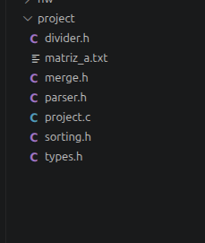

- divider.h: Cabecera que se encarga de calcular los limites de los indices (inferior y superior) para repartir las filas de la matriz a los procesos.
- matriz$\_a$.txt: Archivo txt de la matriz.
- merge.h: Cabecera encargada de la mezcla y fusión de subarreglos ordenados.
- parser.h: Cabecera encargada de leer los datos del archivo txt y transformarlos a un archivo binario mapeado en memoria compartida.
- project.c: Programa principal
- sorting.h: Cabecera de ordenamiento que ejecutan los hilos mediante qsort.
- types.h: Cabecera de definicion de tipos de datos base del proyecto.

En el programa principal se realiza la creación de los procesos mediante la llamada al sistema fork(), y cada proceso hijo crea y ejecuta 2 hilos utilizando la función pthread_create().

Para el manejo eficiente de los datos se trabajó con archivos binarios mediante la cabecera parser.h, la cual convierte el archivo de texto original (.txt) a formato binario y lo mapea en memoria virtual con mmap para que los procesos puedan acceder a él de forma compartida.

El tiempo de ejecución se midió con la función clock_gettime() de la biblioteca time.h (utilizando CLOCK_MONOTONIC), lo que proporciona una resolución de nanosegundos.

Finalmente, la cabecera sorting.h define la rutina de ordenamiento que ejecuta cada hilo sobre su subconjunto de datos asignado, utilizando la función estándar qsort() (algoritmo Quicksort).

  

{\Large **Código**}

En la linea 4 llamamos a la función fork(), dependiendo del número de cores a utilizar, si ingresamos como parámetro de 4 cores, se crearán 4 procesos.

En la linea 21 definimos el tipo de datos para hilos, cada proceso tendrá dos hilos por defecto. En las lineas 34 y 47 creamos el hilo, con sus respectivos parámetros, hacer notar que utilizamos la función sort definida en la cabecera sorting.h.

```c
...
for (i = 0; i < cores; i++)
    {
        pid = fork();

        if (pid == -1)
        {
            perror("fork failed");
            _exit(EXIT_FAILURE);
        }

        if (pid == 0)
        {
            limits_t bundle = limits[i];
            thread_bundle_t thread_bundles[NUM_THREADS];
            size_t mid = (bundle.inf + bundle.sup) / 2;

            thread_bundles[0].data = mapped_binary_file;
            thread_bundles[1].data = mapped_binary_file;

            pthread_t threads[NUM_THREADS];
            int thread_result;

            pthread_attr_t attr;
            pthread_attr_init(&attr);
            pthread_attr_setdetachstate(&attr, PTHREAD_CREATE_JOINABLE);

            size_t j;
            /* thread 1 */
            /* prepares thread bundle: inf and sup thread limits */
            thread_bundles[0].inf = bundle.inf;
            thread_bundles[0].sup = mid;

            thread_result = pthread_create(&threads[0], NULL, sort, &thread_bundles[0]);

            if (thread_result)
            {
                perror("thread creation failed");
                exit(EXIT_FAILURE);
            }

            /* thread 2 */
            /* prepares thread bundle: inf and sup thread limits */
            thread_bundles[1].inf = mid + 1;
            thread_bundles[1].sup = bundle.sup;

            thread_result = pthread_create(&threads[1], NULL, sort, &thread_bundles[1]);

            if (thread_result)
            {
                perror("thread creation failed");
                exit(EXIT_FAILURE);
            }

            pthread_attr_destroy(&attr);

            for (j = 0; j < NUM_THREADS; j++)
            {
                thread_result = pthread_join(threads[j], NULL);
                if (thread_result)
                {
                    perror("failed to join thread");
                    exit(EXIT_FAILURE);
                }
            }

            merge(mapped_binary_file, bundle.inf, mid, bundle.sup);

            _exit(EXIT_SUCCESS); /* necessary for the for loop to terminate */
        }
    }


...
```

Para delegar el trabajo a los hilos POSIX (`pthreads`), se definió la estructura `thread_bundle_t` (líneas 6–11), la cual empaqueta el puntero de memoria compartida en (`data`) junto con los índices inferior (`inf`) y superior (`sup`) que delimitan los datos asignados a cada hilo.

La función `sort()` recibe dicho paquete, calcula la cantidad exacta de elementos a procesar y ejecuta la rutina estándar `qsort()`. El criterio de ordenamiento es ascendente. Finalmente, se operan sobre segmentos de memoria disjuntos (gracias a mmap), cada hilo finaliza su ejecución mediante `pthread_exit(NULL)` sin requerir banderas de sincronización como (*mutex*).

```c
#include <stdlib.h>
#include <pthread.h>

#include "types.h"

typedef struct
{
    data_t *data;
    size_t inf;
    size_t sup;
} thread_bundle_t;

int compare_doubles(const void *a, const void *b)
{
    data_t arg1 = *(const data_t *)a;
    data_t arg2 = *(const data_t *)b;

    if (arg1 < arg2)
        return -1;
    if (arg1 > arg2)
        return 1;

    return 0;
}

void *sort(void *thread_bundle)
{
    thread_bundle_t bundle = *(thread_bundle_t *)thread_bundle;

    size_t number_of_elements = bundle.sup - bundle.inf + 1;
    qsort(bundle.data + bundle.inf, number_of_elements, sizeof(data_t), compare_doubles);

    pthread_exit(NULL);
}
```

Una vez que los hilos concluyen el ordenamiento local de sus respectivos bloques, la cabecera `merge.h` se encarga de consolidar los subarreglos ordenados mediante dos funciones principales:

- **`merge()`:** Implementa la fusión estándar de dos subarreglos adyacentes delimitados por los índices `[inf, mid]` y `[mid + 1, sup]`.
- **`merge_partitions()`:** Orquesta la fusión global de todas las particiones.

```c
...

void merge(data_t *arr, size_t inf, size_t mid, size_t sup)
{
    size_t i, j, k;
    size_t n1 = mid - inf + 1;
    size_t n2 = sup - mid;

    data_t *L = (data_t *)malloc(n1 * sizeof(data_t));
    data_t *R = (data_t *)malloc(n2 * sizeof(data_t));

    if (L == NULL || R == NULL)
    {
        perror("malloc failed");
        exit(EXIT_FAILURE);
    }

    for (i = 0; i < n1; i++)
        L[i] = arr[inf + i];
    for (j = 0; j < n2; j++)
        R[j] = arr[mid + 1 + j];

    i = 0;
    j = 0;
    k = inf;
    while (i < n1 && j < n2)
    {
        if (L[i] <= R[j])
        {
            arr[k] = L[i];
            i++;
        }
        else
        {
            arr[k] = R[j];
            j++;
        }
        k++;
    }

    while (i < n1)
    {
        arr[k] = L[i];
        i++;
        k++;
    }
    while (j < n2)
    {
        arr[k] = R[j];
        j++;
        k++;
    }

    free(L);
    free(R);
}

void merge_partitions(data_t *arr, limits_t *limits, size_t num_partitions)
{
    size_t step;
    for (step = 1; step < num_partitions; step *= 2)
    {
        size_t i;
        for (i = 0; i + step < num_partitions; i += 2 * step)
        {
            size_t inf = limits[i].inf;
            size_t mid = limits[i + step - 1].sup;
            size_t sup = limits[i + 2 * step - 1 < num_partitions ? i + 2 * step - 1 : num_partitions - 1].sup;

            merge(arr, inf, mid, sup);
        }
    }
}

#endif // MERGE_H
```

---

{\Large **Compilación**}

Localizarse en la carpeta ../project/, estando en la carpeta

Compilar de la siguiente manera:

\begin{ubuntuterm}
(*@\prompt{user@user}{ /project} gcc -o project.o project.c -pthread \cursor@*)
\end{ubuntuterm}

Ejecutar el archivo .o, dando los parámetros definidos a continuación:

\begin{ubuntuterm}
(*@\prompt{user@user}{ /project} ./project.o matriz_a.txt 4 y\cursor@*)
\end{ubuntuterm}

- Primer parámetro es el archivo de texto con la matriz deseada, en este caso, txt dado por el profesor.
- Segundo parámetro es el número de procesos
- Tercer parámetro: Se escribirá en un archivo final de texto (y) o solo se ordenará (n)

Al ejecutar de esta forma se creará el archivo de texto "sorted$\_$matrix.txt"
el cual contendrá los elementos ordenados.

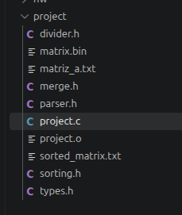

---

Archivo visualizado en editores de texto

El archivo se ordenará de forma ascendente esto es de menor a mayor.

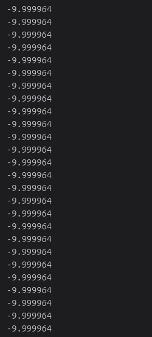

---

{\Large **Resultados**}

{\large **Con parámetro "y" escritura de archivo**}

\text{**1 proceso**}

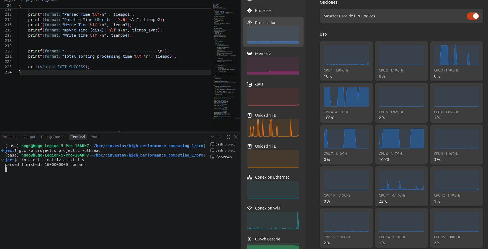

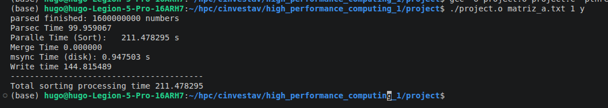

Tiempo ordenamiento sort : 211.47 segundos

\text{**8 proceso**}

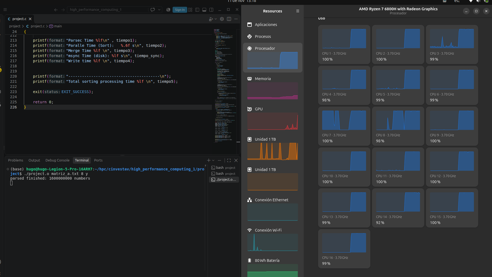

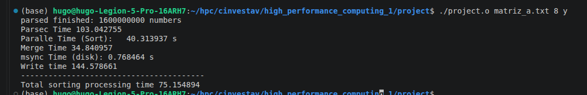

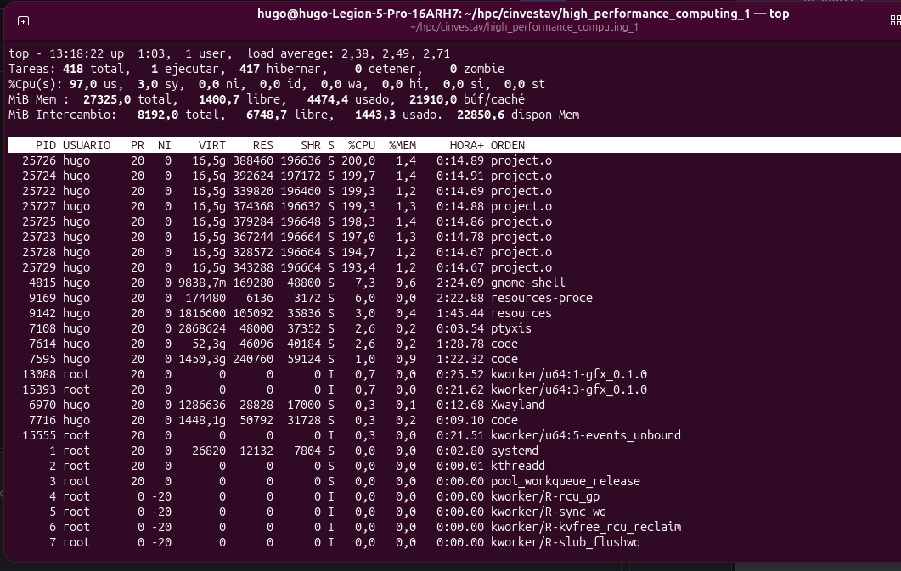

Tiempo ordenamiento sort : 40.31 segundos

---

{\large **Gráfica Procesos vs tiempo de ejecución**}

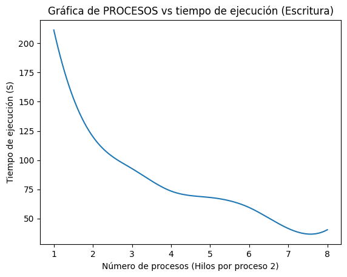

Con parámetro "n" sin escritura de archivo

\text{**1 proceso**}

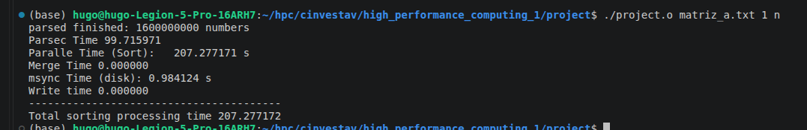

Tiempo ordenamiento sort : 207.27 segundos

\text{**8 proceso**}

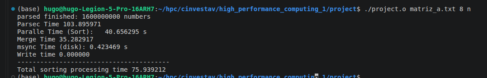

Tiempo ordenamiento sort : 40.65 segundos

{\large **Gráfica Procesos vs tiempo de ejecución**}

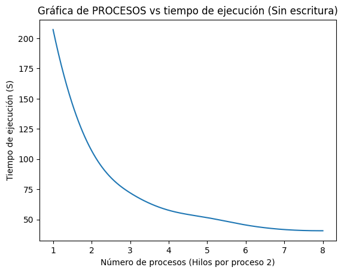
